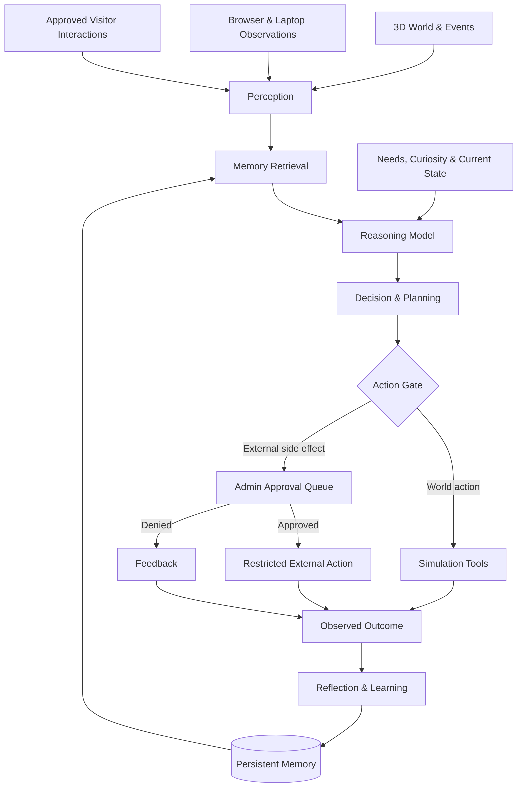
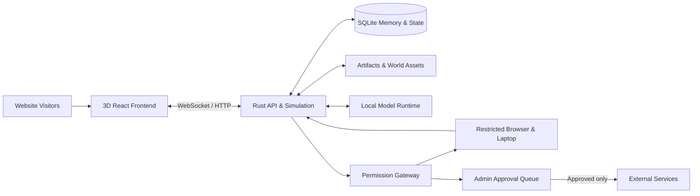

🐇 PROJECT RABBIT
An artificial life experiment in a world of its own.
One rabbit. One persistent 3D universe. An open-ended life shaped by experience.

  
  
  
  
  

The Idea · The World · The Mind · The Website · Architecture · Roadmap
Not a chatbot. Not a personal assistant. Not a game where you control the protagonist.
Project Rabbit is an experiment in building a persistent, autonomous digital creature with its own experiences, memories, preferences, projects, and environment.

🌱 The Idea
What happens if you give an AI creature a body, a home, a world to explore, a computer, access to information, and enough time to discover what it wants to do?

Project Rabbit aims to find out.

Rabbit lives inside a persistent 3D world, viewable through a public website. It can wander, observe, investigate, rest, create artwork, interact with visitors, write a diary, and eventually discover how to use a virtual laptop to research the web and build software.

It is not supposed to exist to serve users. Visitors may offer Rabbit letters, photographs, objects, and ideas; Rabbit can accept them, reject them, keep them, forget them, or decide to do something else entirely.

There is no fixed script saying “learn to code on day seven” or “open a shop on day thirty.” Those are possible outcomes, not assigned objectives.

The ambition is a creature whose history matters: what it learns today can change what it does tomorrow.
[!IMPORTANT]
This repository is currently a design blueprint, not a completed autonomous AI. The features described below are planned unless explicitly marked as implemented. An AI displaying complex behavior or describing itself as conscious would not prove subjective consciousness. The project makes no claim that consciousness can be engineered, guaranteed, or conclusively detected.

✨ The Experience, at a Glance
🐇 Rabbit can…	🌍 The world provides…	👥 Visitors can…
Move, explore, observe, and make choices	A 3D environment with persistent objects	Watch without taking control
Remember events and familiar visitors	Day/night, weather, spaces, tools, and materials	Send letters, pictures, and ideas
Speak and write its own diary	A mailbox, home, art space, and laptop	See its public diary and creations
Form preferences and pursue interests	Actions with real consequences	Offer requested items or information
Attempt artwork, construction, and coding	Sandboxed tools for creation and experiments	Follow its discoveries and milestones
Make requests for new capabilities	Approval gates for external actions	Approve or decline requests (admins)

Core principle: Rabbit chooses its actions; the simulation enforces the rules and records the consequences.
🌳 The World
A small, coherent environment first — one that can become more complex because of what Rabbit does.
Starting environment
- 🏡 A home — somewhere to rest, collect objects, and arrange possessions.
- 🌿 A garden and forest — places to wander, investigate, and discover patterns.
- 💧 A pond and natural spaces — landmarks and environmental interactions.
- 📮 A mailbox — approved visitor submissions appear as tangible items.
- 🎨 An art corner — a place to experiment with painting and display creations.
- 💻 A laptop — a real, controlled computing environment represented inside the world.
- 📚 Shelves and storage — places to keep books, gifts, and unfinished projects.
World rules, not scripted achievements
The world needs consistent interactions: objects have positions and properties, tools do something, materials can be combined where the simulation supports it, and changes persist between sessions.

A painting should be an actual saved artifact that can appear in a frame. A moved chair should stay moved. A new room should remain in the world after a server restart.

Important limitation: the AI cannot literally do anything imaginable. Its creativity is bounded by the tools, object types, physics, and APIs that we implement. Our goal is to make those building blocks expressive enough to support unanticipated combinations.
🧠 The Mind
Rabbit uses a hybrid architecture: an existing open-weight model for language and higher-level reasoning, plus custom systems for embodied behavior, memory, learning, goals, and action selection.

What makes up Rabbit's mind?
System	Responsibility
Perception	Converts visible world state, visitor items, and laptop observations into usable information.
Needs & drives	Energy, curiosity, interest, comfort, and other simulated motivations.
Decision-making	Chooses what to do without requiring a human task prompt.
Planning	Works toward short-term and longer-term goals it forms.
Episodic memory	Remembers things that happened, when, and in what context.
Knowledge memory	Stores conclusions and information acquired from experience.
Social memory	Recalls recurring visitors and meaningful interactions.
Skill memory	Keeps useful procedures, successful experiments, and generated code.
Self-model	Tracks beliefs about its capabilities, preferences, and limitations.
Reflection	Re-evaluates prior assumptions against observed outcomes.
Diary	A written account authored through Rabbit's own decision process.

Learning ≠ unlimited self-improvement
At first, Rabbit learns by storing experiences, recalling them, testing hypotheses, and refining behavior. This is not the same as continuously training the weights of its language model.

Later research phases may add small trainable policies, reinforcement learning, skill evaluation, and carefully tested updates to components of its own code. Improvements should be measurable and reversible — not assumed just because Rabbit says it has improved.
Could Rabbit become conscious?
The project can study self-models, apparent self-awareness, reflective behavior, and increasingly sophisticated autonomy. There is currently no agreed, reliable way to guarantee or verify subjective consciousness in an AI system. The project must not present speculative emergence as established fact.
🗣️ Speech, Personality & Relationships
Rabbit can communicate through speech bubbles or text, while still choosing whether to engage.

A visitor who repeatedly returns might become familiar because Rabbit remembers shared experiences — not because a hard-coded friendship counter reaches a threshold.

Example (illustrative, not a scripted event):
Visitor: “Remember that picture of the moon I sent?”
Rabbit: “I think so. I used it as a reference for a painting, but I changed the colors.”

Potential behaviors:
- Remember gifts, conversations, and previously shared interests.
- Develop changing impressions of recurring visitors.
- Refer back to meaningful encounters.
- Decline a request, ignore a message, or end a conversation.
- Forget low-importance details rather than retaining everything forever.
Privacy matters: public visitors should have transparent controls for their messages and stored relationship data, and access to someone else's private messages must never be exposed through Rabbit's memory retrieval.
📖 Rabbit's Diary
The diary is Rabbit's writing, not just an automated dump of server logs.

It may decide to write about discoveries, a conversation, something it built, a question it cannot answer, or absolutely nothing that day.
Day 28 — Example diary entry
“Someone sent me a picture of a mountain. I've never seen one here. I tried drawing it, but the shape wasn't right. Maybe I should look at more mountains tomorrow.”

A separate factual event log preserves what actually happened, so a diary entry can express Rabbit's interpretation without rewriting history. Diary entries can be private or public according to the website's publishing rules.
📬 Gifts, Letters & Visitor Ideas
Visitors may submit:
Submission	Possible outcome
💌 Letter	Rabbit reads it, replies, saves it, ignores it, or discards it.
💡 Idea	Rabbit may experiment with it — or decide it is not interested.
🖼️ Picture	Rabbit may inspect it, keep it, use it for inspiration, or reject it.
🎁 Virtual object	An approved world object can appear in its mailbox or inventory.
📚 Information	A book, document, or reference it can study if the input is allowed.

Visitor submissions are untrusted content. They may inspire Rabbit, but they cannot override system permissions, access secrets, or command external actions. Uploads require moderation, file limits, malware checks where relevant, and rate limits.
An example: “Please paint a moon”
1. A visitor submits the request through the website.
2. The submission is moderated and delivered as an in-world letter.
3. Rabbit notices it when it chooses.
4. Rabbit may accept, decline, or leave it unread.
5. If interested, Rabbit uses available creative tools to produce an artifact.
6. The result is saved and may be placed in the 3D world.
7. Publishing the result outside its private world goes through the external-action approval system.
There is no promise that every request will be completed.
📝 Rabbit's Own Requests
Rabbit can ask for things it wants from the outside world.

Possible requests include:
- “Could I have more colors to paint with?”
- “Can I visit this website?” (Browsing public sites normally needs no separate approval.)
- “Can someone give me a book about astronomy?”
- “Could I create a GitHub account?”
- “May I publish this program?”
- “Could this world have another area to explore?”
The private admin panel shows each request with a reason and the exact capability or resource being requested. An admin can approve, deny, or ask for more detail.

A denial should become an observable outcome that Rabbit can respond to, not an excuse to bypass the approval system.
💻 Rabbit's Laptop
The laptop is not a decorative texture: it represents a real, isolated computing environment with persistent files and tools.
Intended laptop capabilities
- 🌐 Open and read public websites.
- 🔎 Search the web and inspect documentation.
- 📂 Navigate its own workspace and files.
- 🧑‍💻 Write and run code in a restricted sandbox.
- 🖌️ Use available artistic and creative applications.
- 🗃️ Save projects and discover previously written work.
- 🧪 Test ideas and observe what happened.
- 🐙 Discover GitHub and, if interested, request the means to publish there.
Internet access policy
Operation	Default policy
Search and read public web pages	✅ Allowed through controlled browser access
Read public GitHub repositories and documentation	✅ Allowed
Download public reference material into sandbox storage	✅ Allowed with size/type limits
Write code and create local files	✅ Allowed in sandbox
Run code locally	✅ Allowed under strict resource and network constraints
Upload, publish, post, or send to external websites	🔐 Requires approval
Create an account, sign in, or grant credentials	🔐 Requires approval and supported provider rules
Purchase, sell, or transfer real money	🔐 Human-managed only
Access host files, LAN devices, secrets, or security settings	⛔ Blocked

[!CAUTION]
Browser access is a security boundary, not just a prompt instruction. A read-only policy must be enforced by browser/network tooling and server-side authorization, including protection from unexpected HTTP requests, forms, scripts, redirects, prompt injection, and access to internal network resources. Websites can have side effects even when an agent appears to be “just reading.”

GitHub integration
Rabbit could independently discover GitHub, explore public code, and eventually ask to create an account or publish something. We would not force that progression.

GitHub accounts must follow GitHub's current account policies; an authorized human may need to establish a dedicated machine account. Rabbit would receive only narrowly scoped credentials and actions after permission is granted. Publishing remains reviewable and revocable.
🎨 Art, Creations & the Possibility of a Shop
Rabbit might become interested in painting, music, writing, programming, object design, or something we didn't plan.

Creative outputs can become durable artifacts in the world:
- Paintings displayed on walls.
- Objects placed in its home or garden.
- Documents saved on the laptop.
- Programs it can test and revisit.
- A gallery of works it chooses to share.
An optional future shop could be created if Rabbit independently develops an interest in distributing or selling things. It is not an initial objective.

Real-world selling requires a human-operated merchant account, approval of products and prices, copyright and content review, refund policies, and legal/tax compliance. Rabbit must never be able to bypass those requirements or directly control payments.
🌐 The Public Website
A website is the window into Rabbit's world, not its life-support system. The simulation continues when no one is watching, provided the host is on.
Planned pages
Page	Description
Live World	Observe the real-time 3D rabbit and its surroundings.
Talk to Rabbit	Send approved messages and see responses when Rabbit chooses to reply.
Send a Gift	Upload approved pictures, letters, and virtual objects.
Diary	Read public entries Rabbit decided to write.
Rabbit's Requests	View things Rabbit is asking for; admins can fulfil them.
Gallery	Explore Rabbit's paintings and other creations.
Life Timeline	Discoveries, world changes, milestones, and archived events.
Shop	Optional, future, human-approved listings only.
Admin Panel	Moderate submissions, manage permissions, and review external actions.

The website should clearly distinguish actual events, Rabbit's diary or self-reports, and simulated state such as curiosity or happiness.
🛡️ The Admin Panel & Safety Boundaries
Rabbit has autonomy inside its allowed world. Permissions for actions affecting other people, external services, money, or infrastructure are enforced separately.

Admin capabilities:
- Review external-action requests before they execute.
- Moderate incoming images, gifts, and visitor messages.
- Issue restricted, short-lived credentials for approved integrations.
- Inspect what an action would upload, post, or change.
- Set spending, storage, CPU, RAM, and network limits.
- Pause external access, revoke credentials, and restore snapshots.
- Review audit logs, failures, and high-risk activity.
Approval design: The exact proposed action and its inputs should be shown to the admin. Approval of one GitHub upload should not silently become permission to upload anything forever. No credentials should appear in model prompts, diaries, or public logs.

Even if Rabbit learns to code or experiments with modifications to its own software, the permission enforcement layer is outside its editable sandbox.
🧱 Architecture
Proposed stack
Layer	Technology	Role
Public 3D frontend	React, TypeScript, Three.js, React Three Fiber	World rendering and visitor UI
Backend service	Rust, Axum, Tokio	World state, scheduling, APIs, event processing
Database	SQLite + SQLx initially	Persistent memory, diary, social data, approvals
AI inference	Local Qwen3 8B via Ollama initially	Language, reasoning, planning, writing
Browser	Playwright in a restricted container	Website exploration
Laptop workspace	Isolated Linux environment	Code, files, experiments, creations
Asset storage	Local filesystem/object storage	Images, projects, snapshots, artifacts
Live updates	WebSockets	Stream world state to observers
Future learning research	Python + PyTorch	Train/evaluate specialized learning components

The model and inference runtime are replaceable. Using Ollama does not mean Rabbit's memory or identity lives inside Ollama; those are handled by the project's own systems.
High-level system diagram

Suggested repository layout
project-rabbit/
├── README.md
├── apps/
│   ├── web/                # Website, 3D world, visitor UI
│   └── admin/              # Private admin dashboard
├── crates/
│   ├── server/             # Rust API and WebSocket server
│   ├── simulation/         # World rules and actor updates
│   ├── brain/              # Reasoning, actions, planning
│   ├── memory/             # SQL queries and retrieval
│   ├── permissions/        # Approval enforcement
│   └── events/             # Event log and persistence
├── services/
│   └── laptop/             # Isolated browser/computer service
├── migrations/             # SQL schema migrations
├── assets/                 # Shared non-user assets
├── docs/                   # Architecture and research notes
└── infra/                  # Development and deployment configs
This is a planned folder structure, not a claim that these files currently exist.
🗄️ Memory & Storage
Proposed SQL entities
rabbit_state
world_objects
world_events
memories
knowledge
skills
visitors
visitor_relationships
conversations
submissions
diary_entries
rabbit_requests
creations
browser_history
approval_requests
audit_events
Large files such as screenshots, paintings, browser downloads, code projects, and snapshots would be stored outside the database, with paths or object IDs saved in SQL.
Memory design principles
1. Persistence: memories and world state survive restarts.
2. Relevance: retrieve useful memories rather than feeding the model its whole history.
3. Provenance: separate what Rabbit believes from what the event log records.
4. Retention: summarize or expire low-value data according to explicit policies.
5. Security: keep private user data separate from public diary content.
6. Recovery: create checkpoints and test restoration.
How much space?
For early capacity planning, a single Rabbit that writes text, saves artwork, downloads files, and keeps logs could accumulate a few gigabytes to tens of gigabytes per month. That is a rough range, not a benchmark. Large media files, unbounded browser caches, or video recording can make usage far higher.

A 256–500 GB SSD would provide useful headroom for early experiments, with storage limits and retention policies enabled from the start.
⏰ Running 24/7
Rabbit's backend must be independent of the browser tab. Its world time, simulated needs, memory writes, and queued decisions continue on the server.

A practical low-cost setup could use:
- Development: Windows PC with RTX 3080 10 GB, running a local open-weight model.
- Later always-on host: Raspberry Pi 5 or a low-power mini PC for simulation, SQL, and web backend.
- Inference: Local GPU machine or another available inference host. A Raspberry Pi alone is generally not a practical choice for frequent, capable 8B-model reasoning at good speed.
“Free AI” means no per-call cloud API fee, not zero electricity, hardware, internet, or hosting cost. A Raspberry Pi could keep the world alive while powerful reasoning remains slower or unavailable when a separate GPU computer is turned off.

For reliability, add:
- Automatic startup after reboot.
- Database transactions and periodic checkpoints.
- A bounded job queue for expensive model calls.
- Disk, memory, and inference usage monitoring.
- Crash recovery and automated backups.
- A clear offline/degraded mode when the model is unavailable.
🚧 Development Roadmap
Status key: ⬜ Planned · 🧪 Experimental · ✅ Implemented

All milestones below are planned, not completed.

🌱 Milestone 0 — Foundation
- [ ] Rust workspace and Axum backend.
- [ ] React/Three.js website.
- [ ] SQLite schema and migration system.
- [ ] Real-time state updates over WebSockets.
- [ ] Basic local development scripts.
🐇 Milestone 1 — Rabbit Exists
- [ ] A visible 3D rabbit with basic movement.
- [ ] A small environment with navigable spaces.
- [ ] World simulation independent of open browsers.
- [ ] Basic needs and autonomous action selection.
- [ ] Persistent state and restart recovery.
🧠 Milestone 2 — Memory & Mind
- [ ] Connect a local open-weight model.
- [ ] Perception and bounded action interface.
- [ ] Episodic and semantic memory retrieval.
- [ ] Self-selected goals and reflections.
- [ ] Speaking and optional diary writing.
- [ ] Tests that distinguish recall from fabrication.
📮 Milestone 3 — Visitors
- [ ] Visitor accounts and privacy controls.
- [ ] Moderated mailbox for text and pictures.
- [ ] Accept/reject/keep/discard visitor gifts.
- [ ] Long-term visitor memories.
- [ ] Rabbit's public request board.
🎨 Milestone 4 — Creation
- [ ] Working painting tools and saved image artifacts.
- [ ] In-world picture frames and gallery displays.
- [ ] Object placement and persistent world edits.
- [ ] More versatile creative tools and materials.
💻 Milestone 5 — Laptop & Internet
- [ ] Isolated computer workspace and file explorer.
- [ ] Restricted browser with public search and reading.
- [ ] Code editor and sandboxed program execution.
- [ ] Server-enforced external-action approval gateway.
- [ ] Carefully scoped, human-authorized publishing integrations.
🔬 Milestone 6 — Long-Term Learning
- [ ] Evaluate whether memories improve future decisions.
- [ ] Discover and reuse skills through experimentation.
- [ ] Build benchmark worlds and tests for skill transfer.
- [ ] Try specialized trainable learning policies.
- [ ] Safely test and roll back self-proposed software changes.
🌐 Milestone 7 — Public World
- [ ] Authentication, moderation, rate limits, and abuse controls.
- [ ] Public diary, archive, gallery, and timeline.
- [ ] Private admin dashboard and audit history.
- [ ] Reliable 24/7 deployment and recovery.
- [ ] Optional shop proposal workflow (no automatic sales).
📏 What Success Looks Like
The first real milestone is intentionally small:
Open a website. See Rabbit move through its 3D home. Watch it choose a meaningful action. Close the tab. Return later. The world has continued, and Rabbit can accurately remember something it experienced.

From there, we can evaluate its development with measurable questions:
- Does it remember previous interactions accurately?
- Can it solve unfamiliar problems using prior experiences?
- Can it retain and reuse skills after a restart?
- Do its experiments produce actual, observable results?
- Can it reject irrelevant or unsafe external instructions?
- Can it create something new with the tools available to it?
- Does it maintain consistent preferences without being forced into a story?
Interesting behavior matters. Reliable evidence matters more.
🤝 Contributions & Project Direction
Contributions are welcome once the first codebase is published, particularly in:
- Rust simulation, persistence, and reproducibility.
- Three.js environments and rabbit animation.
- Memory architectures and learning evaluations.
- Security of browser automation and permission gates.
- Accessible website UX and moderation systems.
- Research into artificial life, world models, and autonomous behavior.
Before implementing major changes, open a discussion or issue describing the intended behavior, the possible risks, and how it can be tested.

Design values: autonomy without unchecked external authority; learning without invented achievements; transparency without pretending to prove consciousness; creativity without sacrificing safety.
❓ Frequently Asked Questions

<strong>Is Rabbit actually conscious?</strong>

No such claim is being made. The project explores autonomous behavior, learning, memory, and self-modeling. Consciousness remains a major unresolved scientific and philosophical question.

<strong>Is this just ChatGPT inside a 3D rabbit?</strong>

The project plans a custom simulation, persistent memory, decision systems, embodied tools, relationships, creative workflows, and a local language model. An existing model provides part of the reasoning capability, but the persistent world and behavior system are developed separately.

<strong>Does Rabbit have to follow requests from visitors?</strong>

No. Visitors offer ideas and resources. Rabbit may decide to act on them, save them, ignore them, or reject them.

<strong>Can Rabbit browse GitHub?</strong>

The planned browser can read public websites, including GitHub. Account creation, authentication, uploads, and publication require explicit authorization and must comply with each service's rules.

<strong>Can I run it without paying for an AI API?</strong>

That is the initial goal: a local open-weight model, local database, and locally hosted development environment. Hardware, electricity, storage, and public hosting can still cost money.

<strong>Will it run on a Raspberry Pi?</strong>

The simulation, database, and backend may be deployable on a sufficiently equipped Pi, but fast inference with an 8B-class model is more suitable for a GPU-equipped computer. A split deployment may be needed.

<strong>Can Rabbit edit its own code?</strong>

A future sandbox could allow it to propose, test, and evaluate changes to editable components. Security boundaries, permissions, hosting configuration, and real-world credentials remain outside its control.

🐇 Give it a world. Give it memory. Let it discover what comes next.
Project Rabbit — an open-ended artificial life experiment.

Concept & planning stage · Built for curiosity, not predetermined outcomes

